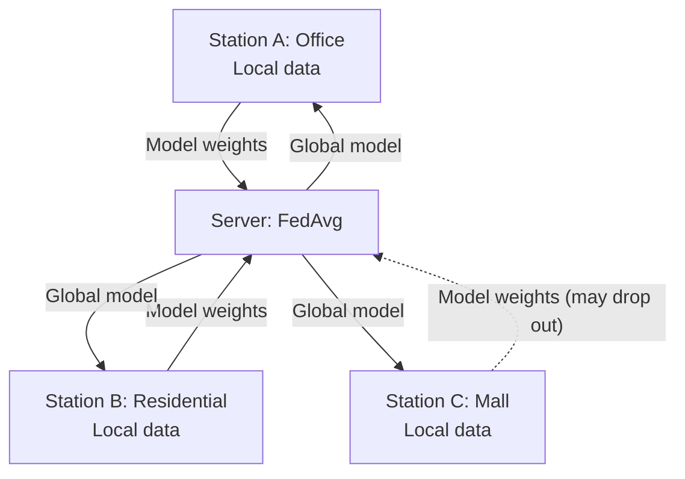
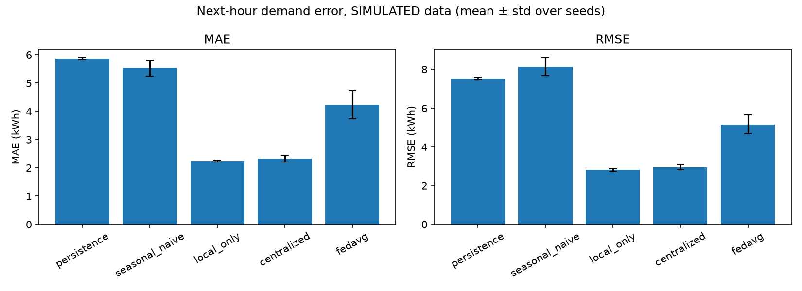
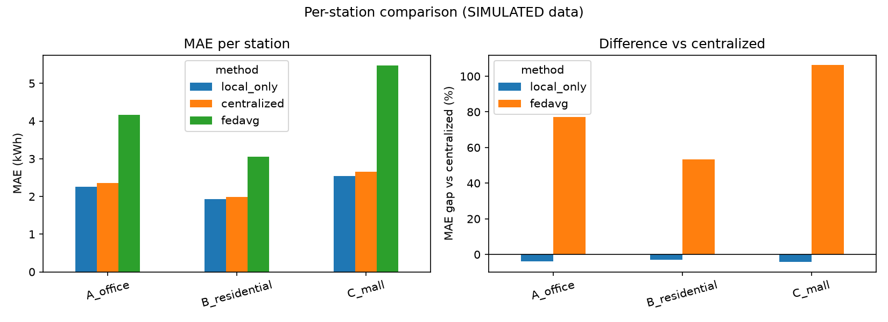
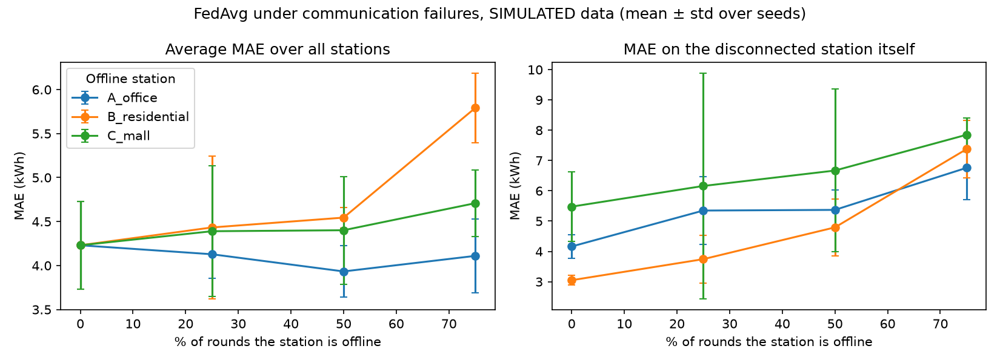

# Robust EV Charging Demand Prediction Using Federated Learning

> **All data in this repository is SIMULATED.** No real charging-station data was used.

A small prototype that predicts next-hour energy demand at three simulated EV charging
stations, comparing baselines, centralized training, and federated learning (FedAvg),
then testing how communication failures affect FedAvg.

## Why
Charging stations may not be able to share raw data (privacy, ownership), and networks fail.
This project asks: how much accuracy does federated training cost, and what happens when a
station drops out of training rounds?

## Architecture

Raw data never leaves a station; only model weights are exchanged.

## Setup
- 3 stations, 120 days of hourly demand each, different daily/weekly patterns plus noise
- Input: previous 24 hours + hour/day encodings. Target: next-hour demand (kWh)
- Model: MLP (28 → 32 → 16 → 1), PyTorch
- Chronological 80/20 train/test split; 3 random seeds
- FedAvg: 100 rounds, 1 local epoch per round

## Results (SIMULATED data, mean ± std over 3 seeds)
| Method | MAE (kWh) | RMSE (kWh) |
|---|---|---|
| Persistence | 5.87 ± 0.03 | 7.53 ± 0.06 |
| Seasonal naive | 5.53 ± 0.28 | 8.14 ± 0.46 |
| Local only | 2.24 ± 0.03 | 2.81 ± 0.06 |
| Centralized | 2.33 ± 0.12 | 2.95 ± 0.13 |
| FedAvg | 4.23 ± 0.50 | 5.15 ± 0.49 |




### Communication failures
One station is offline in a fraction of rounds. MAE on the disconnected station itself:

| Offline station | 0% | 25% | 50% | 75% |
|---|---|---|---|---|
| A_office | 4.16 | 5.35 | 5.37 | 6.76 |
| B_residential | 3.05 | 3.74 | 4.79 | 7.38 |
| C_mall | 5.48 | 6.16 | 6.67 | 7.85 |



## Findings
- FedAvg was clearly worse than centralized and local-only training in this setup.
- Local-only models matched centralized training, so pooling gave no benefit for these very different stations.
- The disconnected station's own error rose as it missed more rounds; the other stations were affected much less.

## Limitations
- Simulated data, one small model, 3 seeds, limited tuning; differences in averages across
  dropout levels are often within seed noise.
- FedAvg's gap is likely related to non-IID stations, but this was not tested.

## Future work
FedProx / personalized federated learning, real charging data, more stations, realistic
network failure models, privacy mechanisms (differential privacy, secure aggregation).

## Run
```
uv venv --python 3.12
uv add numpy pandas scikit-learn matplotlib
uv pip install torch --index-url https://download.pytorch.org/whl/cu124
.venv\Scripts\python -m src.data
.venv\Scripts\python -m src.evaluate
```
A GPU is optional; the code falls back to CPU.